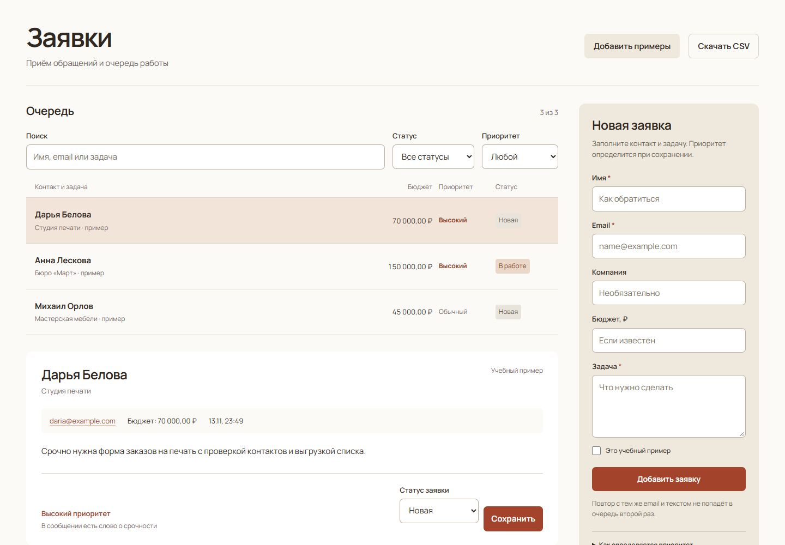

# Заявки

Список обращений из JSON превращается в очередь работы. Приложение проверяет контакты, назначает приоритет и объясняет, почему строка добавлена, пропущена или требует исправления.

## Запуск

1. Установите [Node.js 22 или новее](https://nodejs.org/), если его ещё нет.
2. Скачайте проект через **Code → Download ZIP**, распакуйте архив целиком.
3. В Windows откройте `start.bat`. В браузере появится `http://127.0.0.1:4191`.

Установка npm-пакетов не нужна. Окно запуска оставьте открытым; для остановки нажмите `Ctrl+C`. Альтернатива в терминале: `node server.js` или `npm start`, затем откройте указанный адрес. На macOS/Linux используйте терминал.

## Проверить за минуту

1. Нажмите **Обработать пример**. На пустой очереди отчёт покажет три добавленные заявки, один повтор с пробелами и заглавными буквами в email и одну ошибку в адресе.
2. Нажмите кнопку ещё раз. Отчёт покажет те же строки, но новые заявки не появятся.
3. Откройте Анну Лескову в очереди: высокий приоритет присвоен из-за бюджета 150 000 ₽. Поменяйте статус на **В работе**, сохраните и нажмите **Скачать CSV**.

## Свой список

Скачайте [образец JSON](examples/request-batch.json) прямо из приложения или возьмите его из папки `examples/`. Файл должен быть в UTF-8, до 200 000 байт и с массивом из 1–100 объектов. Обязательны `name`, `email` и `message`. Поля `company` и `budget` необязательны. `demo: true` помечает вымышленную заявку.

Кнопка **Выбрать JSON** сразу запускает обработку. Принятые строки сохраняются вместе. Ошибочные строки перечислены в отчёте по номерам. Их можно поправить в файле и загрузить повторно: уже принятые строки будут пропущены. После перезапуска сохраняются очередь, статусы и сводка в истории. Подробный отчёт показывает последний импорт в текущей вкладке.

Разовую заявку можно ввести через форму **Новая заявка**. Поиск работает по имени, email, компании и задаче, фильтры — по статусу и приоритету. Сначала показаны заявки высокого приоритета, внутри группы — новые сверху. CSV выгружает всю очередь независимо от фильтров.

## Что автоматизировано

- Убираются пробелы по краям, email приводится к нижнему регистру.
- Проверяются имя, email, длина описания и бюджет.
- Совпадение нормализованного email и текста считается повтором. Регистр текста и количество пробелов при сравнении не важны.
- Высокий приоритет назначается при бюджете от 100 000 ₽ или словах «срочно», «сегодня», «горит», asap, urgent. Причина видна в заявке.
- Заявка, её статус и история действий записываются в файл. Повтор тоже отмечается в истории.

## Устройство проекта

**JavaScript / Node.js 22+**: встроенный HTTP-сервер в `server.js`, обработка и сохранение в `engine.js`. **HTML/CSS и браузерный JavaScript**: интерфейс в `public/`. Зависимостей нет: проект проще скачать и проверить без установки библиотек.

`data/requests.json` создаётся после первого сохранения. Запись идёт через временный файл и переименование; при ошибке прежнее состояние остаётся в памяти. Не запускайте два процесса с одной папкой данных. Перед изменением или удалением `data/` остановите приложение и сделайте копию. Для переноса своей очереди сохраните эту папку; в Git и передаваемые архивы она не входит.

Полная история ограничена последними 1000 действиями, интерфейс показывает 20 последних. Обработка одного пользователя; входа по паролю нет. Приложение доступно только на компьютере, где запущено. Оно не подключено к почте или CRM, не отправляет сообщений и не оценивает заявки нейросетью. Приоритеты — редактируемые правила, а не бизнес-прогноз. Слова о срочности ищутся по фрагменту: например, «несрочно» тоже совпадёт.

Если порт занят, проверьте, не открыто ли приложение. Для другого порта: `$env:PORT=4291; node server.js` в PowerShell, затем адрес из окна запуска. Если потеряна связь — проверьте окно запуска и обновите страницу. При повреждении `data/requests.json` приложение откажется запускаться; восстановите файл из своей копии. Автоматического восстановления нет.

## Передача и GitHub

Папка готова для отдельного репозитория. Инструкция и отложенная загрузка: [GITHUB.md](GITHUB.md). В проекте нет аккаунтов, ключей или рабочих данных; примеры в `examples/` вымышленные. Перед передачей исключите свою `data/`.

Шрифт Manrope поставляется локально, условия — `public/fonts/OFL.txt`. Реализация интерфейса собственная; чужие изображения и компоненты не включены.
